# Golu Padi (Golu steps) DIY

A foldable, stackable 9-step plywood Golu Padi (each step 6 ft long x 1 ft wide), with an interactive 3D viewer and a cut plan for standard 8 ft x 4 ft boards.

**Open `index.html` in a browser** (needs internet for three.js from a CDN). Glass interface with light and dark studio themes, a turntable mode and six camera presets. Three modes:

- **Exploded view**: every piece pulled apart (plates, spacers, feet, hinged links, pivot tabs, back panels, treads).
- **Pack & stack**: animated fold of each 3-wall block on four-bar links, then stacking of treads, panels and blocks.
- **Cut plan**: numbered cut lines for every 8x4 board; click a piece to highlight it in 3D.

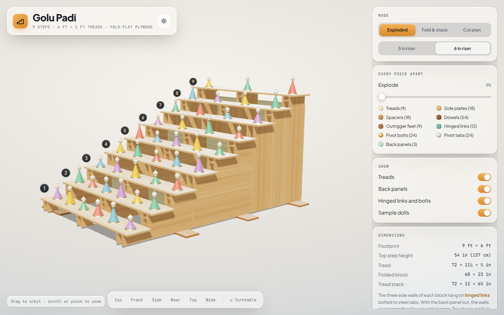

## Pictures

Real screenshots of the viewer, 6 in riser. The page renders with filmic tone mapping, studio image-based lighting, procedural birch plywood (grain on faces, ply layers on cut edges), brushed-steel tabs and brass pivot bolts. Open `index.html` to orbit, explode and play the fold yourself.

### Exploded: every piece apart

Plates, spacers, dowels, feet, hinged links, pivot tabs and bolts, back panels and treads. The camera pulls back as the slider explodes the model.

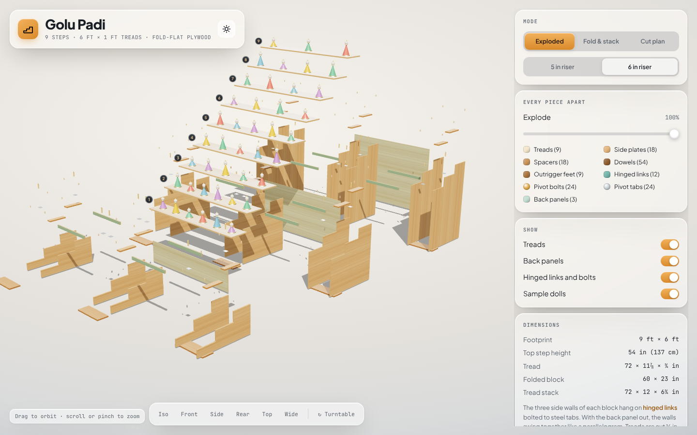

### Unstack in reverse, stack in this order

| | |
|---|---|
| **1. Treads off and stacked** 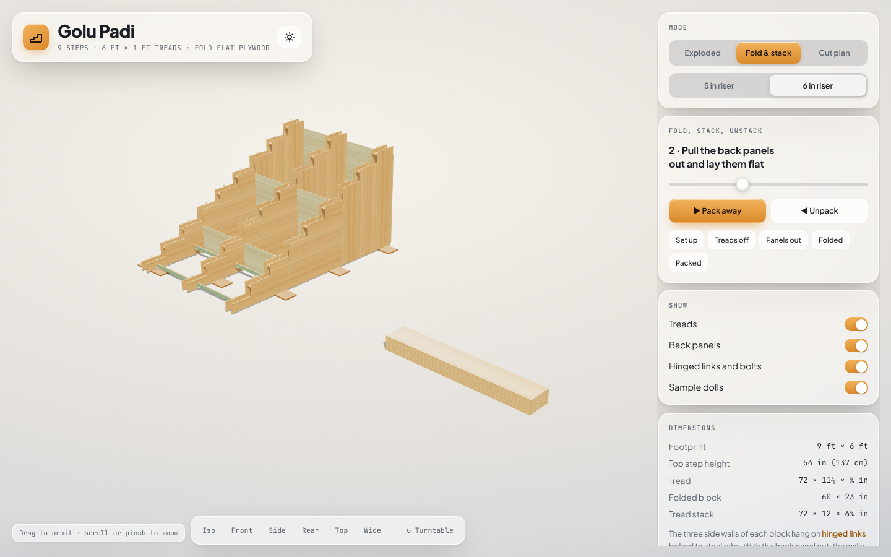 | **2. Back panels out, laid flat** 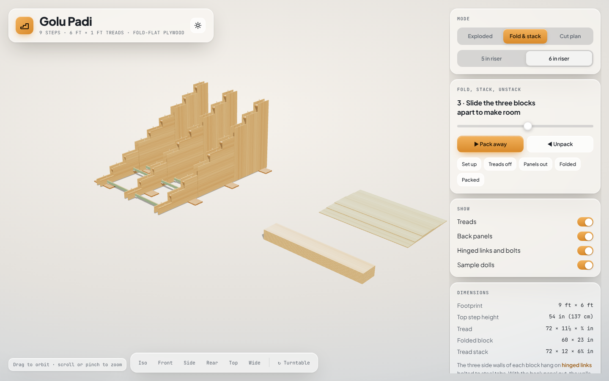 |
| **3. Hinged links swing each block's 3 walls together** 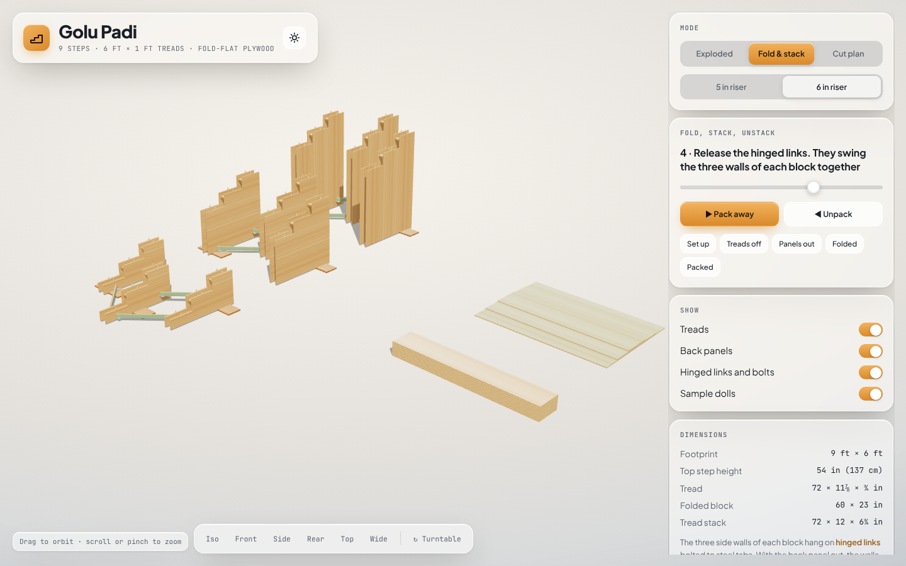 | **4. Blocks folded** 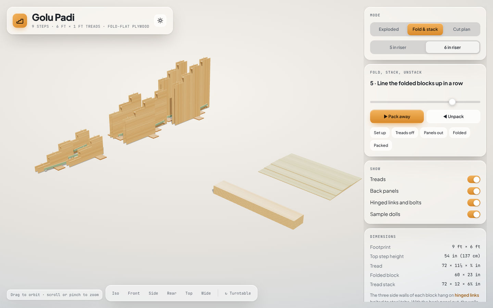 |
| **5. Packed: 3 slim blocks, 1 tread stack, 3 flat panels** 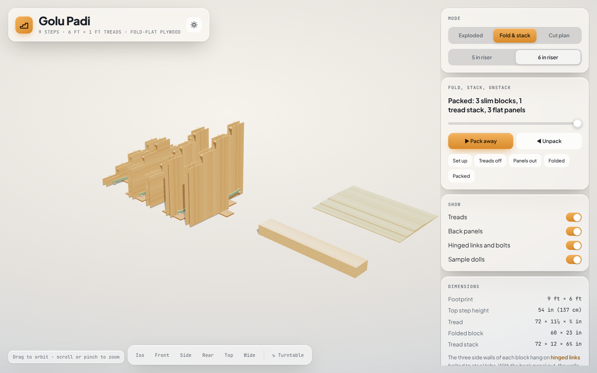 | **Cut plan in 3D: model coloured by source board** 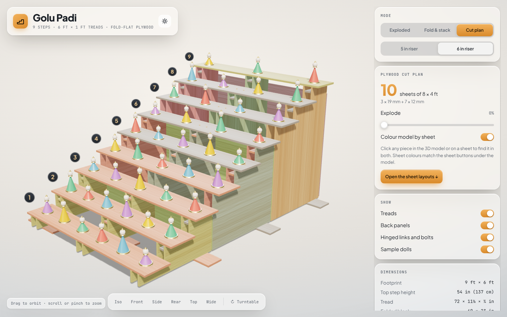 |

### Cut plan: numbered saw cuts on each 8 × 4 board

Sheet 1 shown. Click any piece on a sheet or in 3D to find it in both.

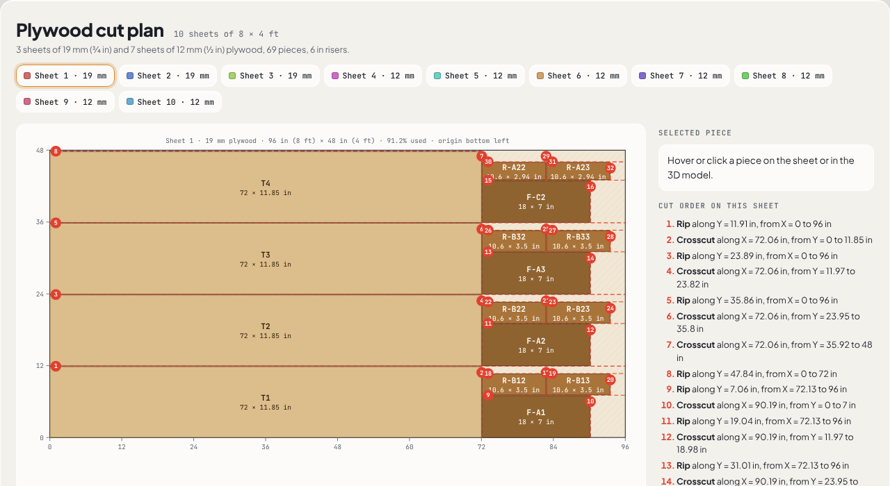

### Dark studio and phone

| | |
|---|---|
| 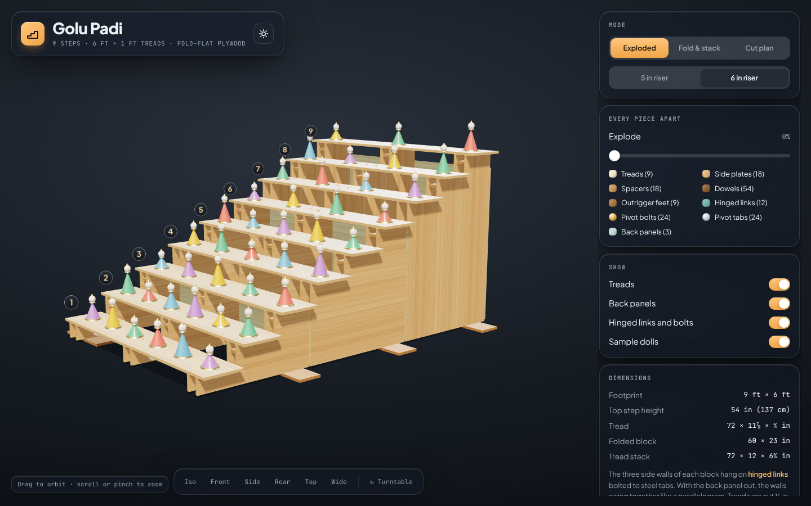 | 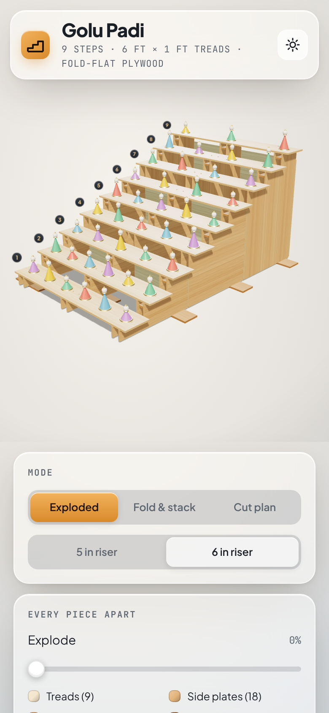 |

## Bill of boards

| Riser height | Total 8x4 boards | 19 mm | 12 mm |
|---|---|---|---|
| 6 in | 10 | 3 | 7 |
| 5 in | 9 | 3 | 6 |

69 cut pieces, 1/8 in saw kerf allowed. A plates are 19 mm, B and C plates 12 mm (a deliberate mix to save a board; use 19 mm for tall block C if you want it stiffer).

## Hardware (estimates, verify before buying)

54 dowels 12x28 mm; 24 steel pivot tabs; 24 M8x70 bolts with wing nuts and 48 washers; 18 M8x40 bolts with T-nuts; 18 M6x40 bolts with inserts; about 200 screws; 500 ml wood glue.

## Caveats

- Folding links are 1.75 in wide and may flex; use hardwood or double them.
- The folded stack is rigid only with the bolts and back panel in place.
- Pivots are removable bolts (assumed), on steel tabs outside the plate faces.
- Not yet reviewed in a real browser or built physically. Treat as a design, not a tested product.

## Files

`index.html` page; `golu-model.js` 3D model; `golu-anim.js` explode/fold/pack timeline; `golu-cutui.js` cut-plan UI; `golu-cuts.js` generated cut data; `plan.py` nesting solver (`python3 plan.py` regenerates cuts); `smoke.js` headless collision test (`node smoke.js`).
